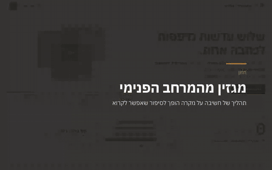

# מגזין מהמרחב הפנימי

**[https://magazinishy.vercel.app](https://magazinishy.vercel.app)**

המיזוג האחרון, בלי Vercel: https://raw.githack.com/Anat1969/MagazinIshy-GH/main/app/index.html



שלוש עדשות נדפסות לכתבה אחת.
מקרה מ[מרחב פנימי](https://merhav-pnimi.vercel.app) נקרא דרך הביוגרפית, הצמצום והבודהיסטית, והופך לכתבה בקול של [מהות](https://magazin-gh.vercel.app).

## הרצה
```
npm install
npm run dev
```

## בדיקה
```
npm run build && npm test
```

## מבנה
- `src/pages`: בית, מקרים להפקה, גיליון, כתבה.
- `src/components/Press.tsx`: המכבש, שלוש הפלטות.
- `supabase/functions/ishy-compose`: Gemini החינמי, Claude כגיבוי.
- `supabase/migrations`: הטבלה `ishy_articles`.

החלטות ותעודת DNA: `CLAUDE.md`.
